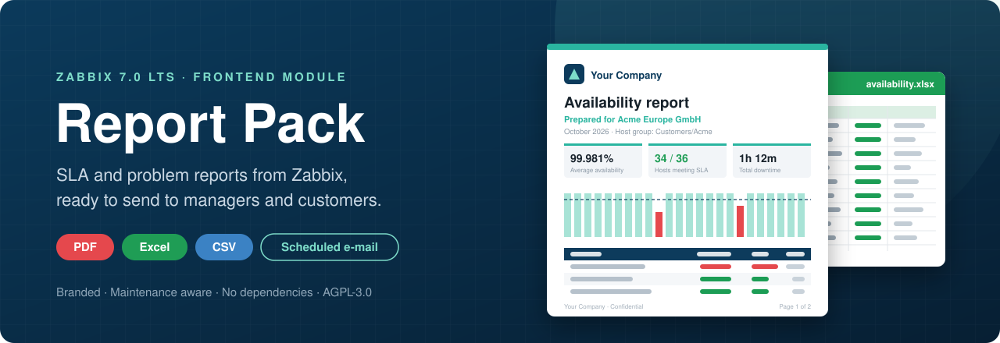
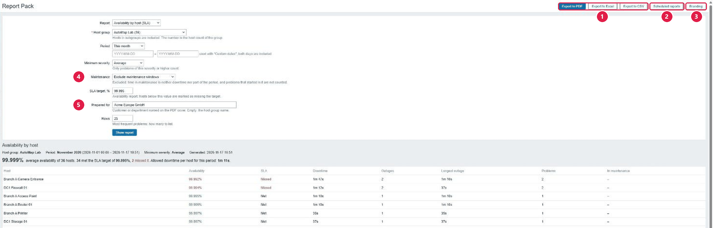
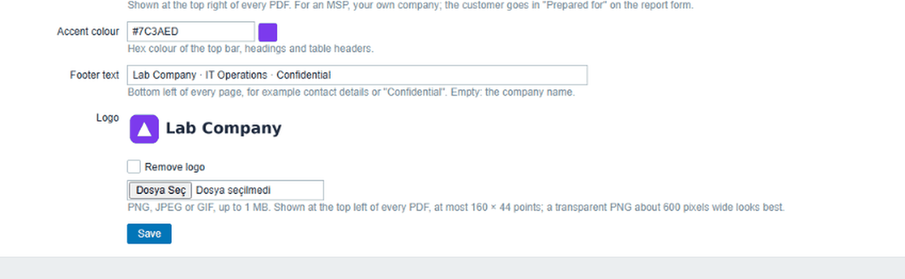
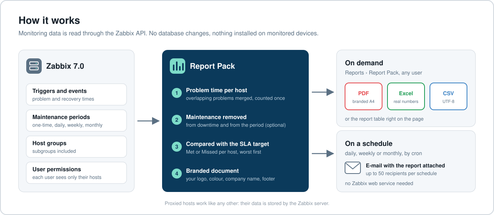
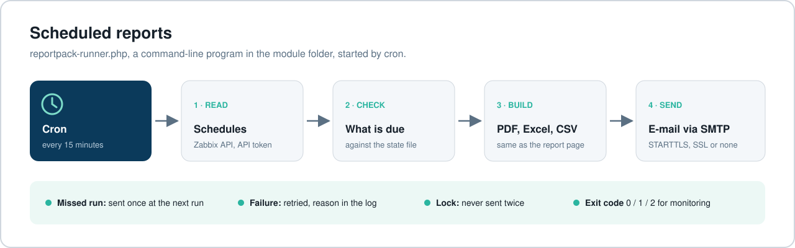
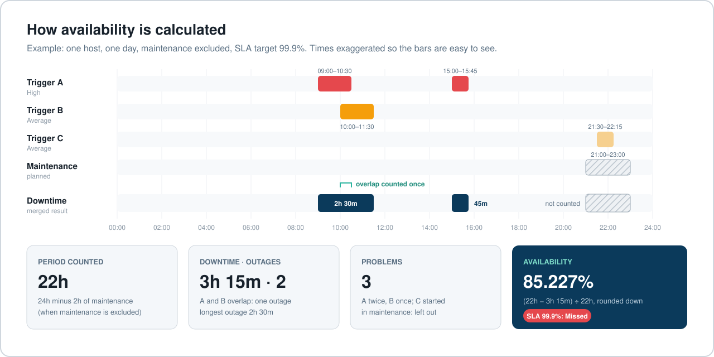

<p align="center">
  
</p>

<p align="center">
  
  
  
  
  
</p>

<p align="center">
  <a href="#installation">Installation</a> ·
  <a href="#creating-a-report">Usage</a> ·
  <a href="#scheduled-reports">Scheduled reports</a> ·
  <a href="#how-the-numbers-are-calculated">SLA calculation</a> ·
  <a href="docs/Report-Pack-User-Guide.pdf">User guide (PDF)</a> ·
  <a href="docs/Report-Pack-Kullanim-Kilavuzu.pdf">Türkçe kılavuz</a>
</p>

---

**Report Pack** is a frontend module for Zabbix 7.0 LTS. It turns what Zabbix already knows about your hosts into reports you can hand to a manager, an auditor or a customer: availability per host measured against an SLA target, and the problems that occurred most often. Reports open on screen and export as a branded PDF, an Excel workbook or CSV, and they can be e-mailed automatically every day, week or month.

## Contents

- [Why Report Pack](#why-report-pack)
- [Features](#features)
- [Screenshots](#screenshots)
- [How it works](#how-it-works)
- [Requirements](#requirements)
- [Installation](#installation)
- [Creating a report](#creating-a-report)
- [What is in the files](#what-is-in-the-files)
- [Branding](#branding)
- [Scheduled reports](#scheduled-reports)
- [How the numbers are calculated](#how-the-numbers-are-calculated)
- [Permissions and security](#permissions-and-security)
- [Proxies, HA and multiple sites](#proxies-ha-and-multiple-sites)
- [Troubleshooting](#troubleshooting)
- [FAQ](#faq)
- [Known limitations](#known-limitations)
- [Roadmap](#roadmap)
- [Development and tests](#development-and-tests)
- [License](#license)

## Why Report Pack

Zabbix shows the state of a network very well, but a monthly availability report for a manager or a customer usually means screenshots and spreadsheets put together by hand. The built-in options each cover part of it:

| | Zabbix SLA report | Zabbix scheduled reports | **Report Pack** |
|---|---|---|---|
| Works on | Services you define first | A dashboard | **Host groups and their triggers, no extra setup** |
| Output | Web page | PDF picture of a dashboard | **PDF with figures, chart and table; Excel; CSV** |
| Per-host SLA, downtime, outages | Per service | – | **Yes** |
| Your logo and colours | – | – | **Yes** |
| Extra components | – | Zabbix web service | **None** (cron for e-mail) |

**Who it is for**

- **Managed service providers** that send each customer a monthly availability report under their own brand.
- **IT departments** that report service levels to management.
- **Teams under NIS2, ISO 27001 or internal audits** that need regular, readable evidence that systems are monitored.

## Features

**Reports**
- **Availability by host (SLA)**: availability % per host, SLA target *Met* or *Missed*, downtime, number of outages, longest outage, number of problems, time in maintenance; summary tiles and a daily availability chart.
- **Most frequent problems**: host, problem name, severity, how many times it started, total duration and when it last started.
- **Periods**: this month, last month, last 7 days, last 30 days or two dates of your choice.
- **Filters**: host group (subgroups included), minimum severity, SLA target, maintenance excluded or counted.

**Formats**
- **PDF**: A4, multi-page, table headers repeated on every page, your branding on every page. The font is embedded, so names with accented Latin, Cyrillic or Greek letters (Ü, Ł, Ş, Ж, Ω…) print correctly.
- **Excel (.xlsx)**: real numbers and real durations that add up beyond 24 hours, frozen header, filters on, a summary sheet with all report settings.
- **CSV**: UTF-8 with byte order mark so Excel shows every character, durations in seconds and in readable form.

**Delivery**
- On screen for every Zabbix user, limited to the hosts they may see.
- **Scheduled e-mail**: daily, weekly or monthly, up to 50 recipients, subject and message with placeholders.

**Built to be easy to run**
- No Composer packages, no external libraries: the PDF, Excel and ZIP writers are part of the module.
- No agent or extra software on monitored devices, no database schema changes.
- Spreadsheet values that look like formulas (`=`, `+`, `-`, `@`) are stored as text, so a host name can never run as a formula.

## Screenshots

<p align="center">
  
  &nbsp;
  
</p>
<p align="center">
  
  &nbsp;
  
</p>

Sample files: [availability report (PDF)](docs/samples/availability.pdf) · [most frequent problems (PDF)](docs/samples/top_problems.pdf)

## How it works

<p align="center">
  
</p>

## Requirements

| | |
|---|---|
| Zabbix | 7.0 LTS (developed and tested on 7.0.32) |
| Rights | Super admin to enable the module and to change branding and schedules; any user can create reports |
| Fonts | DejaVu Sans, which Zabbix uses for its graphs (present on packages and the appliance) |
| Scheduled reports | PHP 8.0+ on the command line with `mbstring` (and `openssl` for HTTPS or encrypted mail), an API token of a Super admin user, a mail server |

## Installation

1. Copy the module into the Zabbix frontend's `modules` folder:

   ```sh
   git clone https://github.com/CodeByPinar/zabbix-reportpack.git
   cp -r zabbix-reportpack/ReportPack /usr/share/zabbix/modules/
   chmod -R u=rwX,go=rX /usr/share/zabbix/modules/ReportPack
   ```

   Without Git, download the ZIP from the [Releases](https://github.com/CodeByPinar/zabbix-reportpack/releases) page and copy the `ReportPack` folder the same way.

2. In Zabbix open **Administration › General › Modules**, press **Scan directory** and enable **Report Pack**.
3. Open **Reports › Report Pack**.

**Upgrading**: replace the `ReportPack` folder with the new one. Branding and schedules are kept, because they are stored in the Zabbix database, not in the folder.

**Removing**: disable the module under **Administration › General › Modules**, then delete the folder. A saved logo stays under **Administration › General › Images** as *Report Pack logo* and can be deleted there.

## Creating a report

1. Open **Reports › Report Pack**.
2. Fill in the form:

   | Field | Description |
   |---|---|
   | Report | *Availability by host (SLA)* or *Most frequent problems* |
   | Host group | The hosts to report on. Hosts in subgroups are included, so one parent group per customer gives one report per customer. |
   | Period | This month, last month, last 7 days, last 30 days, or two dates. Both dates are included in full; a period still running ends now. |
   | Minimum severity | Only problems of this severity or higher count. *Average* leaves out warnings and information. |
   | Maintenance | Exclude planned maintenance windows, or count them as normal time. |
   | SLA target, % | Hosts below it are marked *Missed*. |
   | Prepared for | The customer or department named on the PDF and in the Excel file. Empty: the host group name. |
   | Rows | Problem report only: how many problems to list. |

3. Press **Show report**. The result appears under the form, worst host or most frequent problem first.
4. Press **PDF**, **Excel** or **CSV** to download it.

## What is in the files

**PDF**

| Part | What it shows |
|---|---|
| Header | Accent bar, logo, company name, report title, *Prepared for*, exact period, host group, minimum severity, time of creation |
| Summary tiles | Average availability, hosts meeting the SLA, total downtime, allowed downtime per host (problem report: problems started, triggers, time in problem state) |
| Daily chart | Average availability per day with the SLA target as a dashed line; days below the target in red |
| Table | One row per host or problem; long names wrap; continues on further pages with its header repeated |
| Note | How the figures were calculated and whether maintenance was excluded |
| Footer | Your footer text and *Page x of y* |

A one-to-three page PDF is about 40–60 KB, because only the letters actually used are embedded.

**Excel workbook**

| Sheet | Contents |
|---|---|
| Availability | Host, Availability %, SLA, Downtime, Outages, Longest outage, Problems, In maintenance |
| By day | Day, average availability and downtime of all hosts on that day |
| Problems | Host, Problem, Severity, Times, Total duration, Last started (problem report) |
| Summary | The summary figures and every report setting |

**CSV**: the report table with a header row; every row also states the period and the settings, so a file can be read on its own.

## Branding

The **Branding** button on the report page (Super admin only) sets what every PDF uses:

| Setting | Effect |
|---|---|
| Company name | Top right of every PDF. For a service provider: your own company; the customer goes in *Prepared for*. |
| Accent colour | Top bar, headings, table headers and the Excel header row |
| Footer text | Bottom left of every page, for example contact details or *Confidential* |
| Logo | PNG, JPEG or GIF up to 1 MB, top left. Transparent PNGs work; large images are scaled down when saved. |

## Scheduled reports

<p align="center">
  
</p>

### 1. Create a schedule in Zabbix

**Reports › Report Pack › Scheduled reports › Create scheduled report**. The *Report* tab holds the same fields as the report page plus the file format; the *Delivery* tab holds:

| Field | Description |
|---|---|
| Frequency | Daily, weekly or monthly |
| Weekday / Day of month | For weekly or monthly reports; day 1–28 so every month has it |
| Time | Hour of sending, in the time zone of the machine running the sender |
| Recipients | E-mail addresses separated by commas or new lines, up to 50 |
| Subject, Message | Free text with `{report}`, `{prepared_for}`, `{period}`, `{group}`, `{from}`, `{till}` |

*Example*: report *Availability*, host group *Customers/Acme*, period *Last month*, prepared for *Acme Europe GmbH*, PDF, monthly on day 1 at 07:00. On 1 December the customer receives *“Availability report – Acme Europe GmbH – November 2026”* with the PDF attached.

### 2. Create an API token

The sender reads the schedules with an API token. Schedules live in the module settings, which only Super admins may read.

1. Sign in as a **Super admin** (ideally a dedicated user such as `reportpack`, so the token can be disabled without affecting people).
2. **User settings › API tokens › Create API token**.
3. Name it, for example *Report Pack runner*; set an expiry date or clear the box.
4. Press **Add** and copy the **Auth token** straight away. Zabbix shows it only once.

Keep the token secret: anyone with it can use the API with its user's rights.

### 3. Install the sender

The sender runs on the Zabbix server or on any machine with PHP 8 that can reach the Zabbix web interface and a mail server.

```sh
# Rocky, Alma, Oracle Linux, RHEL (including the Zabbix appliance)
dnf install php-cli php-mbstring
# Debian, Ubuntu
apt install php-cli php-mbstring

cp /usr/share/zabbix/modules/ReportPack/bin/reportpack.ini.example /etc/zabbix/reportpack.ini
chmod 600 /etc/zabbix/reportpack.ini
```

Settings in `/etc/zabbix/reportpack.ini`:

| Setting | Meaning |
|---|---|
| `[zabbix] url` | Address of the Zabbix web interface, e.g. `https://zabbix.example.com/` |
| `[zabbix] token` | The API token |
| `[zabbix] verify_tls` | `yes`; `no` only for a test server with a self-signed certificate |
| `[smtp] host`, `port` | Mail server and port: 587 with STARTTLS, 465 with SSL, 25 without encryption |
| `[smtp] security` | `starttls`, `ssl` or `none` |
| `[smtp] username`, `password` | Mail login; empty if the server accepts mail from this machine without one |
| `[smtp] from`, `from_name` | Sender address and the name recipients see |
| `[runner] state_file` | Where the sender remembers what it sent, e.g. `/var/lib/zabbix/reportpack-state.json` |
| `[runner] timezone` | Time zone for schedule times and periods, e.g. `Europe/Berlin`; empty = the system's |
| `[runner] font` | DejaVu Sans font file; empty = found automatically |

### 4. Test, then add it to cron

```sh
php /usr/share/zabbix/modules/ReportPack/bin/reportpack-runner.php --config /etc/zabbix/reportpack.ini --test-mail you@example.com
php /usr/share/zabbix/modules/ReportPack/bin/reportpack-runner.php --config /etc/zabbix/reportpack.ini --list
```

```
# /etc/cron.d/reportpack
*/15 * * * * root php /usr/share/zabbix/modules/ReportPack/bin/reportpack-runner.php --config /etc/zabbix/reportpack.ini >> /var/log/zabbix/reportpack.log 2>&1
```

| Option | Effect |
|---|---|
| `--list` | Shows every schedule with its last and next run |
| `--run <id or name>` | Sends one schedule now, due or not |
| `--output <folder>` | Writes the files to a folder instead of e-mailing them |
| `--test-mail <address>` | Sends a short test message |
| `--verbose` | Prints the conversation with the mail server; passwords are hidden |

**Behaviour**: a run missed while the machine was off is sent once at the next run; a new schedule does not send for a slot that passed hours before it was created; a failed report is retried at the next run; only one sender runs at a time, so a report is never sent twice. Exit code 0 means everything was sent, 1 that something failed, 2 a wrong command line or settings file.

## How the numbers are calculated

<p align="center">
  
</p>

- **Source**: the trigger events Zabbix stores (problem and recovery). Only enabled triggers of the minimum severity or higher count. Nothing is sampled or estimated.
- **Problem time**: each problem is clipped to the period. A problem already open when the period starts counts from the start; one still open at the end counts until the end. For a trigger that changed state during the period, its state at the start is taken from the last event before the period.
- **Downtime** of a host: the time in which at least one of its triggers was in problem state. Overlapping problems are **merged**, so time with two problems at once counts once.
- **Outages**: the number of these merged stretches. **Longest outage**: the longest of them. **Problems**: the number of problems that started in the period.
- **Maintenance** (when excluded): maintenance time is removed from both the downtime and the period, and problems that started inside maintenance are not counted. One-time, daily, weekly and monthly maintenance periods are expanded and clipped to their active dates.
- **Availability** = (period − downtime) ÷ period, rounded **down** to three decimals, so 99.9996% shows as 99.999%, never as 100%.
- **SLA** is *Met* when the availability shown is at or above the target. **Allowed downtime** is the downtime a host may have in the period and still meet the target (30 days at 99.9% = 43m 12s).
- A trigger that belongs to several hosts counts for each of them.

## Permissions and security

- Reports use the Zabbix API with the rights of the signed-in user, so everyone sees only the hosts they may read.
- Only Super admins can change branding and schedules (Zabbix allows only them to change module settings).
- Scheduled reports use the rights of the token's user.
- The sender refuses to run from the web server: opening its URL gives *404*.
- Keep `reportpack.ini` readable only by the cron user (`chmod 600`); it holds the token and possibly a mail password.

## Proxies, HA and multiple sites

- **Proxies**: data from proxied hosts is stored by the Zabbix server like any other, so those hosts are reported the same way.
- **High availability**: copy the module to every frontend server. Branding and schedules are in the database and shared. Run the sender on **one** machine only.
- **Multiple sites or customers**: give each site or customer a host group (subgroups are included) and create one report or schedule per group.

Proxy and HA setups have not been tested separately yet.

## Troubleshooting

| Symptom | Cause | Fix |
|---|---|---|
| Report Pack is not listed after *Scan directory* | The folder is readable by root only | Run the `chmod` command from the installation and scan again |
| *Branding* and *Scheduled reports* buttons are missing | The user is not a Super admin | Sign in as a Super admin |
| A host shows 100% although it had problems | The problems were below the minimum severity or inside maintenance | Lower *Minimum severity* or count maintenance as normal time |
| “No font file for PDF found” | The Zabbix graph font is missing | Install the DejaVu fonts package of your distribution |
| The PDF has no logo | No logo saved under Branding | Upload a logo under Branding |
| Sender: “Not authorized” | Wrong, expired or non-Super-admin token | Create a new token for a Super admin and update the settings file |
| Sender: “Mail server answered: 535 …” | Mail login refused | Check user name and password; run with `--test-mail` and `--verbose` |
| Sender: “Cannot reach the Zabbix API” | Wrong `url`, firewall, or untrusted HTTPS certificate | Open the address in a browser on the same machine; for a test server set `verify_tls = no` |
| A schedule never sends | Disabled, or cron is not running the sender | Check the schedule list; run `--list` by hand and read the cron log |
| A report arrives at the wrong hour | The sender's time zone differs from what you expect | Set `timezone` in `[runner]` |
| “php: command not found” | No command-line PHP | Install `php-cli` |

## FAQ

**Does Report Pack change anything in Zabbix?**
It only reads monitoring data. It stores its own settings (branding, schedules) in the module configuration and the logo as a Zabbix image.

**Do customers need a Zabbix login?**
No. They receive the PDF or Excel file by e-mail.

**Can each customer get its own report?**
Yes: one host group and one schedule per customer, with the customer's name in *Prepared for* and the customer's addresses as recipients.

**How far back can a report go?**
As far as Zabbix keeps events (the event housekeeping setting). The daily chart covers up to a year.

**Is availability calculated from item data such as ping?**
No, from trigger problems. To report on reachability, make sure each host has a trigger for it (for example the ICMP ping or agent availability triggers from the standard templates) with at least the minimum severity you report on.

## Known limitations

- Reports and spreadsheets are in English.
- One brand for all reports; per-customer logos are not supported yet.
- Maintenance applies to whole hosts; tag conditions inside a maintenance are ignored.
- Hosts without triggers of the minimum severity always show 100%.
- Tested on a 36-host lab network with Zabbix 7.0.32. Performance on large installations (1,000+ hosts) has not been measured yet.
- Zabbix 7.2 and 7.4 have not been tested.

## Roadmap

Planned, not promised:

- Fewer API calls for long periods and a load test with 1,000+ hosts
- Tests on Zabbix 7.2, 7.4 and the next LTS
- Per-customer logo and colours
- Report language other than English
- Maintenance tag conditions

Ideas and bug reports are welcome in [Issues](https://github.com/CodeByPinar/zabbix-reportpack/issues).

## Development and tests

```
ReportPack/            the module (copy this folder into Zabbix)
  actions/             page controllers
  includes/            report logic, PDF, Excel, ZIP and PNG writers, API adapters, mailer
  views/               pages and file downloads
  bin/                 the scheduled-report sender and its example settings
tests/                 tests that run without Zabbix
docs/                  user guides, sample reports, images
```

```sh
php tests/report_test.php            # periods, intervals, maintenance, schedules
php tests/png_test.php               # PNG reader against reference pixels
php tests/pdf_test.php /tmp/out      # writes sample PDFs; needs DejaVuSans.ttf
```

`tests/make_png_cases.py` (Python with Pillow) regenerates the PNG test files.

## Changelog

See [CHANGELOG.md](CHANGELOG.md).

## License

Copyright © 2026 Pınar Topuz.

Report Pack is free software under the [GNU Affero General Public License v3.0](LICENSE), the same license as Zabbix 7.0. You may use, change and share it; if you distribute a changed version or offer it to others over a network, you must make your source code available under the same license.
