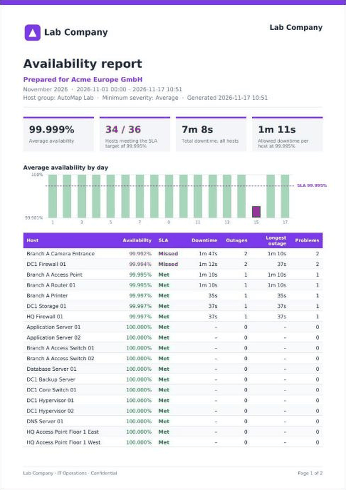
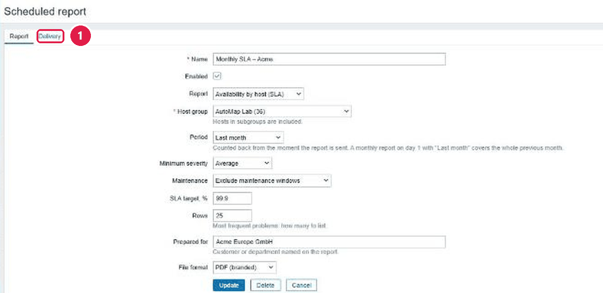

# Report Pack for Zabbix

A Zabbix 7.0 frontend module that turns monitoring data into reports you can hand to managers and customers: availability per host against an SLA target, and the most frequent problems, as a branded PDF, an Excel workbook or CSV, on screen or e-mailed on a schedule.



## Features

- **Availability report**: availability % per host, SLA target met or missed, downtime, number of outages, longest outage, problems; average availability per day as a chart.
- **Most frequent problems**: which triggers fired, how often, for how long and when last.
- **Three formats**: branded PDF (A4, multi-page, table headers repeated), Excel workbook (real numbers and durations, frozen header, filters) and CSV (UTF-8 with BOM).
- **Branding**: logo, accent colour, company name and footer on every PDF page, plus a *Prepared for* line with the customer's name.
- **Maintenance aware**: planned maintenance can be left out of the downtime and the period, or counted as normal time. One-time, daily, weekly and monthly maintenance periods are supported.
- **Scheduled e-mail**: daily, weekly or monthly reports to up to 50 recipients, sent by a small command-line program started by cron. It does not need the separate Zabbix web service.
- **Permissions respected**: every user sees only the hosts their Zabbix permissions allow.
- **No dependencies**: the PDF and Excel writers are part of the module. No Composer packages, no agent or extra software on monitored devices, no database changes.

## Requirements

- Zabbix 7.0 LTS (developed and tested on 7.0.32)
- Super admin rights to enable the module and to change branding and schedules
- For scheduled reports: PHP 8 on the command line (`php-cli` with `mbstring`), an API token of a Super admin user, and a mail server

## Installation

```sh
git clone https://github.com/CodeByPinar/zabbix-reportpack.git
cp -r zabbix-reportpack/ReportPack /usr/share/zabbix/modules/
chmod -R u=rwX,go=rX /usr/share/zabbix/modules/ReportPack
```

Then in Zabbix: **Administration › General › Modules › Scan directory**, enable **Report Pack**, and open **Reports › Report Pack**.

To upgrade, replace the folder with the new one. Branding and schedules are kept: they are stored in the Zabbix database, not in the module folder.

## Usage

1. Open **Reports › Report Pack**.
2. Choose a report, a host group (subgroups are included) and a period: this month, last month, last 7 days, last 30 days or your own dates.
3. Set the minimum severity, the SLA target and whether to exclude maintenance, then press **Show report**.
4. Export with **PDF**, **Excel** or **CSV**.


Branding is set with the **Branding** button, schedules with **Scheduled reports**.

## Scheduled reports

Schedules are created in Zabbix (**Scheduled reports › Create scheduled report**): the report settings, the file format, daily/weekly/monthly timing and the recipients.



The sender `ReportPack/bin/reportpack-runner.php` reads the schedules through the Zabbix API and e-mails what is due:

```sh
dnf install php-cli php-mbstring        # or: apt install php-cli php-mbstring
cp /usr/share/zabbix/modules/ReportPack/bin/reportpack.ini.example /etc/zabbix/reportpack.ini
chmod 600 /etc/zabbix/reportpack.ini    # fill in the Zabbix URL, API token and mail settings

php /usr/share/zabbix/modules/ReportPack/bin/reportpack-runner.php --config /etc/zabbix/reportpack.ini --test-mail you@example.com
php /usr/share/zabbix/modules/ReportPack/bin/reportpack-runner.php --config /etc/zabbix/reportpack.ini --list
```

```
# /etc/cron.d/reportpack
*/15 * * * * root php /usr/share/zabbix/modules/ReportPack/bin/reportpack-runner.php --config /etc/zabbix/reportpack.ini >> /var/log/zabbix/reportpack.log 2>&1
```

A missed run is caught up once at the next run, a failed report is retried, and a report is never sent twice. Other options: `--run <id|name>` sends one schedule now, `--output <folder>` writes files instead of e-mailing them, `--verbose` shows the mail server conversation.

Run the sender on one machine only, also in a Zabbix HA setup.

## How the numbers are calculated

- **Downtime** of a host is the time in which at least one of its enabled triggers of the minimum severity or higher was in problem state. It comes from the trigger events in Zabbix (problem and recovery), clipped to the period. A problem already open when the period starts counts from the start; one still open at the end counts until the end.
- **Overlapping problems** on the same host are merged, so time with two problems at once counts once. *Outages* is the number of these merged stretches; *Problems* is the number of problems that started in the period.
- **Availability** = (period − downtime) / period, rounded down to three decimals so that 99.9996% never shows as 100%.
- **Maintenance**, when excluded, is removed from both the downtime and the period, and problems that started inside it are not counted.
- **Allowed downtime** is the downtime a host may have in the period and still meet the SLA target.

Data from Zabbix proxies is stored by the Zabbix server like any other, so proxied hosts are reported the same way.

## Documentation

- [User guide (English, PDF)](docs/Report-Pack-User-Guide.pdf)
- [Kullanım kılavuzu (Türkçe, PDF)](docs/Report-Pack-Kullanim-Kilavuzu.pdf)
- Sample reports: [availability](docs/samples/availability.pdf), [most frequent problems](docs/samples/top_problems.pdf)

## Known limitations

- Reports and spreadsheets are in English.
- One brand for all reports; per-customer logos are not supported yet.
- Maintenance applies to whole hosts; tag conditions inside a maintenance are ignored.
- Availability is based on triggers: a host without triggers of the minimum severity always shows 100%.
- Tested on a 36-host lab network. Performance on large installations (1,000+ hosts) has not been measured yet.
- Zabbix 7.2 and 7.4 have not been tested.

## Tests

The tests run without Zabbix:

```sh
php tests/report_test.php            # time arithmetic, periods, maintenance, schedules
php tests/png_test.php               # PNG reader against reference pixels
php tests/pdf_test.php /tmp/out      # writes sample PDFs; needs DejaVuSans.ttf (see the file)
```

`tests/make_png_cases.py` (Python with Pillow) regenerates the PNG test files.

## Changelog

See [CHANGELOG.md](CHANGELOG.md).

## License

Copyright © 2026 Pınar Topuz.

Report Pack is free software under the [GNU Affero General Public License v3.0](LICENSE), the same license as Zabbix 7.0. You may use, change and share it; if you distribute a changed version or offer it to others over a network, you must make your source code available under the same license.
